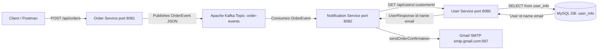
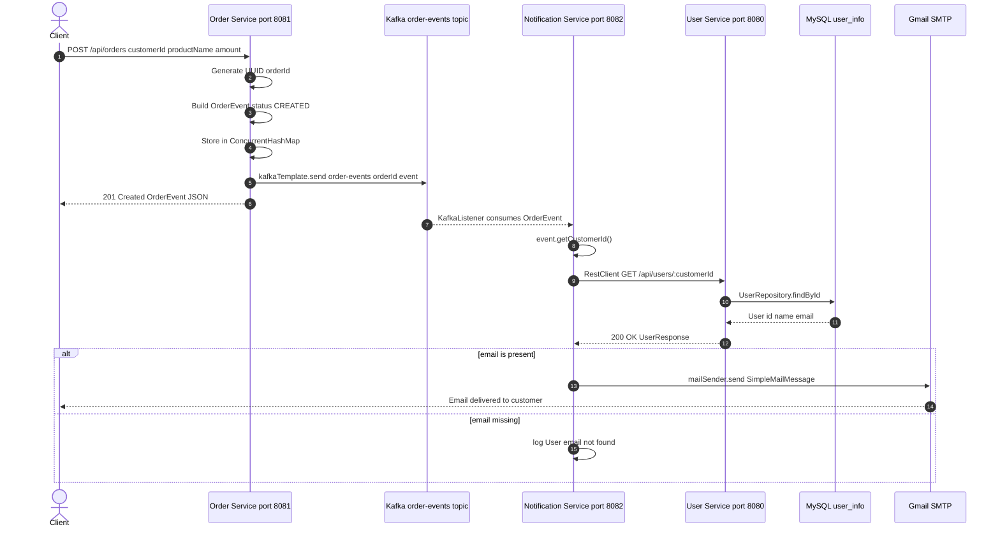

# 📦 Kafka Microservices — Order & Notification System

> A production-style Spring Boot microservices project demonstrating **event-driven architecture** using Apache Kafka, REST APIs, MySQL, and Gmail SMTP — built with Java 21 and Spring Boot 4.1.1.

---

## 📋 Table of Contents

1. [Project Overview](#1-project-overview)
2. [Architecture Diagram](#2-architecture-diagram)
3. [Why Three Microservices?](#3-why-three-microservices)
4. [Complete End-to-End Flow](#4-complete-end-to-end-flow)
5. [Sequence Diagram](#5-sequence-diagram)
6. [Project Folder Structure](#6-project-folder-structure)
7. [Technology Stack](#7-technology-stack)
8. [Kafka Explained in This Project](#8-kafka-explained-in-this-project)
9. [REST API Documentation](#9-rest-api-documentation)
10. [Setup and Installation](#10-setup-and-installation)
11. [End-to-End Testing With Postman](#11-end-to-end-testing-with-postman)
12. [Environment Variables and Security](#12-environment-variables-and-security)
13. [Error Handling and Troubleshooting](#13-error-handling-and-troubleshooting)
14. [Future Improvements](#14-future-improvements)

---

## 1. Project Overview

This project simulates a **real-world e-commerce order processing pipeline** using three independent microservices that communicate through Apache Kafka and REST APIs.

### What problem does it solve?

In a traditional monolithic application, placing an order, notifying customers, and managing user data are all bundled into one large codebase. This makes it hard to scale, maintain, or deploy any one part independently.

This project solves that problem by **separating concerns into dedicated services**:

- **Order Service** handles order creation and publishes events to Kafka.
- **Notification Service** listens for those events and sends email confirmations.
- **User Service** maintains a customer database and exposes a REST API.

### What happens when a customer places an order?

1. A client (Postman or any HTTP client) sends a `POST` request to the **Order Service**.
2. The Order Service creates an order, assigns it a unique ID, and **publishes the order event to Kafka**.
3. The **Notification Service** picks up the event from Kafka automatically.
4. It calls the **User Service** REST API to look up the customer email address.
5. It sends a formatted **order confirmation email** to the customer via **Gmail SMTP**.

The Order Service never directly calls the Notification Service — they are fully **decoupled through Kafka**.

---

## 2. Architecture Diagram



---

## 3. Why Three Microservices?

| Service | Responsibility | Why Separate? |
|---|---|---|
| **Order Service** | Accept order requests, generate order IDs, publish events to Kafka | Can be scaled independently during high traffic peaks; has no knowledge of email or user data |
| **Notification Service** | Consume Kafka events, fetch user details, send emails | Can be paused, redeployed, or scaled without affecting order creation; new notification channels can be added without touching Order Service |
| **User Service** | Manage customer data backed by MySQL | Can be shared by multiple other services; owns the single source of truth for customer identity |

### Benefits of this separation

- **Independent deployability**: Each service can be restarted, updated, or scaled without affecting the others.
- **Fault isolation**: If the Notification Service is temporarily down, orders still get created and events are retained in Kafka. Once it restarts, it resumes consuming from where it left off.
- **Loose coupling**: Order Service does not know Notification Service exists. It only knows how to write to a Kafka topic.
- **Single Responsibility Principle**: Each service does exactly one thing well.

---

## 4. Complete End-to-End Flow

Here is the exact step-by-step flow, verified against the source code:

### Step 1 — Client sends an order request
A client sends an HTTP `POST` to `http://localhost:8081/api/orders` with a JSON body containing `customerId`, `productName`, and `amount`.

**Handler:** `OrderController.createOrder(@RequestBody OrderRequest request)`

### Step 2 — Order Service processes the request
`OrderService.createOrder(OrderRequest request)` generates a random UUID as the `orderId` using `UUID.randomUUID().toString()`. It builds an `OrderEvent` object with status `"CREATED"` and stores it in an in-memory `ConcurrentHashMap<String, OrderEvent>`.

### Step 3 — Order Service publishes the event to Kafka
`kafkaTemplate.send("order-events", orderId, event)` serializes the `OrderEvent` as JSON and publishes it to the Kafka topic `order-events`, using the `orderId` as the message key.

**Serializer:** `JacksonJsonSerializer` (configured in `order-service-kafka/application.properties`)

### Step 4 — Kafka makes the event available
Kafka stores the message in the `order-events` topic. The message remains until the consumer commits its offset.

### Step 5 — Notification Service consumes the event
`OrderEventConsumer.consumeOrderEvent(OrderEvent event)` is annotated with `@KafkaListener(topics = "order-events")`. Spring Kafka deserializes the JSON back into an `OrderEvent` using `JsonDeserializer`.

### Step 6 — Notification Service extracts customerId
The consumer calls `event.getCustomerId()` to retrieve the customer ID from the event.

### Step 7 — Notification Service calls User Service via HTTP
`UserService.getUserById(Long userId)` uses Spring `RestClient` to call `GET http://localhost:8080/api/users/{customerId}`. The base URL comes from `user.service.url=http://localhost:8080`.

### Step 8 — User Service retrieves customer details from MySQL
`UserController.getUserById(@PathVariable Long id)` delegates to `UserService.getUserById(id)`, which calls `UserRepository.findById(id)`. Hibernate executes `SELECT * FROM user_info WHERE id = ?`.

### Step 9 — Notification Service validates and sends the email
Back in `OrderEventConsumer`, if `user.getEmail()` is not null or blank, `EmailService.sendOrderConfirmation()` is called. It creates a `SimpleMailMessage` with subject `"Order Confirmation - ORD-XXXXXXXX"` and a plain-text body. The display ID is `"ORD-" + orderId.substring(0, 8).toUpperCase()`. Finally, `mailSender.send(message)` delivers it via Gmail SMTP.

---

## 5. Sequence Diagram



---

## 6. Project Folder Structure

```
kafka-microservices/
├── compose.yaml                                 # Docker Compose — starts Apache Kafka (KRaft mode, no ZooKeeper)
│
├── order-service-kafka/                         # Microservice 1 — handles order creation
│   ├── pom.xml                                  # Spring Web, Spring Kafka, Jackson, Lombok, Validation
│   └── src/main/
│       ├── java/com/example/demo/
│       │   ├── OrderServiceKafkaApplication.java        # @SpringBootApplication entry point
│       │   ├── controller/
│       │   │   └── OrderController.java                 # POST /api/orders, GET /api/orders, GET /api/orders/{id}
│       │   ├── dto/
│       │   │   ├── OrderRequest.java                    # Incoming body: customerId, productName, amount
│       │   │   └── OrderEvent.java                      # Kafka payload + response: orderId, customerId, amount, productName, status
│       │   └── service/
│       │       └── OrderService.java                    # UUID generation, ConcurrentHashMap store, kafkaTemplate.send()
│       └── resources/
│           └── application.properties                   # port=8081, Kafka bootstrap, JacksonJsonSerializer
│
├── notification-service-kafka/                  # Microservice 2 — consumes events, sends confirmation emails
│   ├── pom.xml                                  # Spring Web, Spring Kafka, Spring Mail, Jackson, Lombok
│   └── src/main/
│       ├── java/com/example/demo/
│       │   ├── NotificationServiceKafkaApplication.java # @SpringBootApplication entry point
│       │   ├── OrderEventConsumer.java                  # @KafkaListener — orchestrates lookup and email
│       │   ├── UserService.java                         # RestClient HTTP client calling User Service
│       │   ├── EmailService.java                        # JavaMailSender + SimpleMailMessage via Gmail SMTP
│       │   └── dto/
│       │       ├── OrderEvent.java                      # Deserialized Kafka message fields
│       │       └── UserResponse.java                    # HTTP response: id, name, email
│       └── resources/
│           └── application.properties                   # port=8082, consumer group, Gmail SMTP, user.service.url
│
└── user-service-kafka/                          # Microservice 3 — customer CRUD backed by MySQL
    ├── pom.xml                                  # Spring Web, Spring Data JPA, MySQL Connector, Lombok
    └── src/main/
        ├── java/com/example/demo/
        │   ├── UserServiceKafkaApplication.java         # @SpringBootApplication entry point
        │   ├── User.java                                # @Entity @Table(name="user_info") — id, name, email
        │   ├── UserController.java                      # POST /api/users, GET /api/users/{id}
        │   ├── UserService.java                         # findById (Optional<User>), saveUser (User)
        │   └── repository/
        │       └── UserRepository.java                  # JpaRepository<User, Long>
        └── resources/
            └── application.properties                   # port=8080, MySQL datasource, JPA/Hibernate ddl-auto=update
```

### Key Class Reference

| Class | Service | Role |
|---|---|---|
| `OrderController` | Order | REST endpoint handler — delegates to `OrderService` |
| `OrderRequest` | Order | Incoming DTO: `customerId`, `productName`, `amount` |
| `OrderEvent` | Order & Notification | Shared DTO serialized to/from Kafka JSON |
| `OrderService` | Order | UUID generation, in-memory storage, `kafkaTemplate.send()` |
| `OrderEventConsumer` | Notification | `@KafkaListener` — receives event, calls `UserService`, calls `EmailService` |
| `UserService` (Notification) | Notification | `RestClient` HTTP client calling User Service API |
| `EmailService` | Notification | Sends confirmation via `JavaMailSender` + `SimpleMailMessage` |
| `UserResponse` | Notification | DTO mapping HTTP response from User Service |
| `User` | User | JPA entity mapped to `user_info` MySQL table |
| `UserController` | User | REST endpoint handler for customer CRUD |
| `UserService` (User) | User | Business logic wrapping `UserRepository` |
| `UserRepository` | User | `JpaRepository<User, Long>` — `findById()` and `save()` |

---

## 7. Technology Stack

| Technology | Version | Used In | Purpose |
|---|---|---|---|
| **Java** | 21 | All services | Primary language |
| **Spring Boot** | 4.1.1 | All services | Auto-configuration, embedded Tomcat, lifecycle management |
| **Spring Web MVC** | via Boot | All services | `@RestController`, `@RequestMapping`, `ResponseEntity` |
| **Apache Kafka** | 4.1.1 Docker | Order, Notification | Distributed event streaming in KRaft mode |
| **Spring Kafka** | via Boot | Order, Notification | `KafkaTemplate`, `@KafkaListener`, JSON (de)serialization |
| **MySQL** | 8.0+ | User | Relational database for `user_info` table |
| **Spring Data JPA** | via Boot | User | Auto-generated CRUD via `JpaRepository` |
| **Hibernate** | via JPA | User | ORM — `ddl-auto=update` manages schema |
| **RestClient** | Spring 6+ | Notification | Fluent HTTP client calling User Service REST API |
| **Spring Mail** | via Boot | Notification | `JavaMailSender` + `SimpleMailMessage` for email dispatch |
| **Gmail SMTP** | smtp.gmail.com:587 | Notification | Email delivery with STARTTLS + App Password auth |
| **Jackson** | via Boot | Order, Notification | `JacksonJsonSerializer` / `JsonDeserializer` for Kafka messages |
| **Lombok** | via Boot | All services | `@Data`, `@RequiredArgsConstructor` reduce boilerplate |
| **Docker Compose** | local | Infrastructure | Runs `apache/kafka:4.1.1` container |
| **Maven** | via mvnw | All services | Build tool — `mvnw spring-boot:run` |

---

## 8. Kafka Explained in This Project

### What is Kafka?

Apache Kafka is a **distributed message streaming platform**. Think of it like a post office: producers drop messages into named mailboxes (called *topics*), and consumers pick them up at their own pace. Messages persist even after being read, so nothing is lost if a consumer is temporarily offline.

### What is a Kafka Topic?

A topic is a **named channel** for messages. In this project, the topic is **`order-events`**. Every time an order is created, an event about that order is placed into this topic.

### What does `order-events` store?

It stores JSON representations of `OrderEvent` objects. Each message contains:

```json
{
  "orderId": "a3f1e2d4-8b5c-4a7e-9f6d-1c2b3a4e5f6d",
  "customerId": 1,
  "amount": 1499.99,
  "productName": "Wireless Headphones",
  "status": "CREATED"
}
```

### How does the Producer publish an event?

In `OrderService.createOrder()`:

```java
kafkaTemplate.send("order-events", orderId, event);
```

- `"order-events"` — topic name
- `orderId` — message key (used for partitioning)
- `event` — `OrderEvent` object, serialized to JSON by `JacksonJsonSerializer`

Producer configuration in `order-service-kafka/application.properties`:

```properties
spring.kafka.producer.key-serializer=org.apache.kafka.common.serialization.StringSerializer
spring.kafka.producer.value-serializer=org.springframework.kafka.support.serializer.JacksonJsonSerializer
```

### How does the Consumer receive an event?

In `OrderEventConsumer`:

```java
@KafkaListener(topics = "order-events")
public void consumeOrderEvent(OrderEvent event) { ... }
```

Spring Kafka deserializes the JSON into an `OrderEvent` using `JsonDeserializer`. Consumer configuration:

```properties
spring.kafka.consumer.key-deserializer=org.apache.kafka.common.serialization.StringDeserializer
spring.kafka.consumer.value-deserializer=org.springframework.kafka.support.serializer.JsonDeserializer
spring.kafka.consumer.properties[spring.json.trusted.packages]=*
spring.kafka.consumer.properties[spring.json.value.default.type]=com.example.demo.dto.OrderEvent
```

### What is a Consumer Group?

The Notification Service uses consumer group `notification-group`:

```properties
spring.kafka.consumer.group-id=notification-group
```

Kafka tracks which messages each consumer group has processed. If the Notification Service restarts, it resumes from the last committed offset — no events are lost.

### What does `auto-offset-reset=earliest` mean?

```properties
spring.kafka.consumer.auto-offset-reset=earliest
```

On first startup (no previously saved offset), start reading from the **very beginning** of the topic so no events are missed.

### Why Kafka instead of a direct HTTP call?

| Direct HTTP Call | Kafka |
|---|---|
| Order Service must wait for Notification Service to respond | Order Service fires and forgets — no waiting |
| If Notification Service is down, order creation fails | Events queue in Kafka; email is sent when service restarts |
| Tight coupling between services | Services are fully decoupled |
| Hard to add more consumers | Any number of consumer groups can subscribe independently |

---

## 9. REST API Documentation

### User Service — `http://localhost:8080`

#### Create a Customer

| Field | Value |
|---|---|
| **Method** | `POST` |
| **URL** | `http://localhost:8080/api/users` |
| **Content-Type** | `application/json` |
| **Success Status** | `201 Created` |

**Request Body:**
```json
{
  "name": "Ayan Sahag",
  "email": "ayan@example.com"
}
```

> Do not include `id` — it is auto-generated by MySQL (`GenerationType.IDENTITY`).

**Response (`201 Created`):**
```json
{
  "id": 1,
  "name": "Ayan Sahag",
  "email": "ayan@example.com"
}
```

---

#### Get a Customer by ID

| Field | Value |
|---|---|
| **Method** | `GET` |
| **URL** | `http://localhost:8080/api/users/{id}` |
| **Found** | `200 OK` |
| **Not Found** | `404 Not Found` (empty body) |

**Example:**
```
GET http://localhost:8080/api/users/1
```

**Response (`200 OK`):**
```json
{
  "id": 1,
  "name": "Ayan Sahag",
  "email": "ayan@example.com"
}
```

> Handled by: `service.getUserById(id).map(ResponseEntity::ok).orElse(ResponseEntity.notFound().build())`

---

### Order Service — `http://localhost:8081`

#### Create an Order

| Field | Value |
|---|---|
| **Method** | `POST` |
| **URL** | `http://localhost:8081/api/orders` |
| **Content-Type** | `application/json` |
| **Success Status** | `201 Created` |

**Request Body:**
```json
{
  "customerId": 1,
  "productName": "Wireless Headphones",
  "amount": 1499.99
}
```

**Response (`201 Created`):**
```json
{
  "orderId": "a3f1e2d4-8b5c-4a7e-9f6d-1c2b3a4e5f6d",
  "customerId": 1,
  "amount": 1499.99,
  "productName": "Wireless Headphones",
  "status": "CREATED"
}
```

> After this response, the Kafka event is already published and the Notification Service processes it asynchronously.

---

#### Get an Order by ID

| Field | Value |
|---|---|
| **Method** | `GET` |
| **URL** | `http://localhost:8081/api/orders/{orderId}` |
| **Status** | `200 OK` |

**Example:**
```
GET http://localhost:8081/api/orders/a3f1e2d4-8b5c-4a7e-9f6d-1c2b3a4e5f6d
```

**Response:**
```json
{
  "orderId": "a3f1e2d4-8b5c-4a7e-9f6d-1c2b3a4e5f6d",
  "customerId": 1,
  "amount": 1499.99,
  "productName": "Wireless Headphones",
  "status": "CREATED"
}
```

> **Note:** Orders are stored in an in-memory `ConcurrentHashMap` and are lost on restart.

---

#### Get All Orders

| Field | Value |
|---|---|
| **Method** | `GET` |
| **URL** | `http://localhost:8081/api/orders` |
| **Status** | `200 OK` |

**Response:**
```json
{
  "a3f1e2d4-8b5c-4a7e-9f6d-1c2b3a4e5f6d": {
    "orderId": "a3f1e2d4-8b5c-4a7e-9f6d-1c2b3a4e5f6d",
    "customerId": 1,
    "amount": 1499.99,
    "productName": "Wireless Headphones",
    "status": "CREATED"
  }
}
```

---

## 10. Setup and Installation

### Prerequisites

| Tool | Version | Download |
|---|---|---|
| Java JDK | 21 | https://adoptium.net |
| Maven | 3.9+ (or use mvnw) | https://maven.apache.org |
| Docker Desktop | Latest | https://www.docker.com/products/docker-desktop |
| MySQL Server | 8.0+ | https://dev.mysql.com/downloads/mysql |
| Eclipse IDE | 2024-03+ | https://www.eclipse.org/downloads |

---

### Step 1 — Verify Java Installation

```powershell
java -version
```
Expected: `openjdk version "21.x.x"`

---

### Step 2 — Start Docker Desktop

Open Docker Desktop and wait until it shows **Engine running**.

---

### Step 3 — Start Apache Kafka

```powershell
cd C:\Users\ayans\Downloads\kafka-microservices
docker compose up -d
```

Verify:
```powershell
docker ps
```
You should see a container named `kafka` on port `9092`.

---

### Step 4 — Create the Kafka Topic (optional)

Kafka auto-creates the topic on first publish, but you can create it manually:

```powershell
docker exec -it kafka /opt/kafka/bin/kafka-topics.sh `
  --create `
  --topic order-events `
  --bootstrap-server localhost:9092 `
  --partitions 1 `
  --replication-factor 1
```

Verify:
```powershell
docker exec -it kafka /opt/kafka/bin/kafka-topics.sh `
  --list `
  --bootstrap-server localhost:9092
```

---

### Step 5 — Set Up MySQL Database

```sql
CREATE DATABASE user_info;
```

Hibernate auto-creates the `user_info` table on first startup (`ddl-auto=update`).

> **Check credentials:** `user-service-kafka/src/main/resources/application.properties` uses `username=root` and `password=261029`. Update these if your MySQL setup differs.

---

### Step 6 — Configure Gmail SMTP Environment Variables

```powershell
# Temporary (current PowerShell session only)
$env:GMAIL_USERNAME = "your.email@gmail.com"
$env:GMAIL_APP_PASSWORD = "your-16-char-app-password"
```

For permanent configuration, use Windows System Properties > Environment Variables (see Section 12).

---

### Step 7 — Import Projects into Eclipse

1. File → Import → Maven → Existing Maven Projects
2. Browse to `C:\Users\ayans\Downloads\kafka-microservices`
3. Select all three `pom.xml` files → Finish

---

### Step 8 — Start Services in Order

**1. User Service first:**
```powershell
cd C:\Users\ayans\Downloads\kafka-microservices\user-service-kafka
.\mvnw spring-boot:run
```
Wait for: `Started UserServiceKafkaApplication on port 8080`

**2. Notification Service:**
```powershell
cd C:\Users\ayans\Downloads\kafka-microservices\notification-service-kafka
.\mvnw spring-boot:run
```
Wait for: `Started NotificationServiceKafkaApplication on port 8082`

**3. Order Service:**
```powershell
cd C:\Users\ayans\Downloads\kafka-microservices\order-service-kafka
.\mvnw spring-boot:run
```
Wait for: `Started OrderServiceKafkaApplication on port 8081`

---

## 11. End-to-End Testing With Postman

### Step 1 — Start Kafka

```powershell
docker compose up -d
docker ps   # verify kafka is running on port 9092
```

### Step 2 — Start User Service

```powershell
cd user-service-kafka
.\mvnw spring-boot:run
```

### Step 3 — Create a Customer

```
POST http://localhost:8080/api/users
Content-Type: application/json

{
  "name": "Ayan Sahag",
  "email": "ayan@example.com"
}
```

Expected response (`201 Created`):
```json
{
  "id": 1,
  "name": "Ayan Sahag",
  "email": "ayan@example.com"
}
```

**Note the `id` value (e.g., `1`) — use it as `customerId` in the order request.**

### Step 4 — Start Notification Service

```powershell
$env:GMAIL_USERNAME = "your.email@gmail.com"
$env:GMAIL_APP_PASSWORD = "your-16-char-app-password"

cd ..\notification-service-kafka
.\mvnw spring-boot:run
```

### Step 5 — Start Order Service

```powershell
cd ..\order-service-kafka
.\mvnw spring-boot:run
```

### Step 6 — Submit an Order

```
POST http://localhost:8081/api/orders
Content-Type: application/json

{
  "customerId": 1,
  "productName": "Wireless Headphones",
  "amount": 1499.99
}
```

Expected response (`201 Created`):
```json
{
  "orderId": "a3f1e2d4-8b5c-4a7e-9f6d-1c2b3a4e5f6d",
  "customerId": 1,
  "amount": 1499.99,
  "productName": "Wireless Headphones",
  "status": "CREATED"
}
```

### Step 7 — Verify Notification Service Logs

In the Notification Service console you should see:
```
Order received: a3f1e2d4-8b5c-4a7e-9f6d-1c2b3a4e5f6d
Confirmation email sent to: ayan@example.com
```

### Step 8 — Verify Email Delivery

Open the inbox of the registered email. You should receive:

**Subject:** `Order Confirmation - ORD-A3F1E2D4`

**Body:**
```
Hello,

Your order has been created successfully.

Order ID: ORD-A3F1E2D4
Product: Wireless Headphones
Amount: 1499.99

Thank you for your order!
```

---

## 12. Environment Variables and Security

### Required Variables

| Variable | Description | Example |
|---|---|---|
| `GMAIL_USERNAME` | Gmail address used as SMTP sender | `your.email@gmail.com` |
| `GMAIL_APP_PASSWORD` | 16-character Google App Password | `abcd efgh ijkl mnop` |

Referenced in `notification-service-kafka/application.properties`:
```properties
spring.mail.username=${GMAIL_USERNAME}
spring.mail.password=${GMAIL_APP_PASSWORD}
```

### How to Generate a Gmail App Password

1. Google Account → Security → enable **2-Step Verification**
2. Search for **App Passwords**
3. App: Mail, Device: Windows Computer → Generate
4. Copy the 16-character password

### Setting Variables Permanently on Windows

1. Press `Win + S` → search **Environment Variables**
2. Click **Edit the system environment variables** → Environment Variables
3. Under **User variables** → New → add `GMAIL_USERNAME` and `GMAIL_APP_PASSWORD`

### Security Rules

- **Never** commit real email addresses or passwords to version control.
- The `spring.datasource.password=261029` in `user-service-kafka/application.properties` **must be replaced with an environment variable** before pushing to a public repository.
- Add the following to `.gitignore` if you store secrets in properties files:

```gitignore
**/application-local.properties
**/application-secret.properties
```

---

## 13. Error Handling and Troubleshooting

> Sections below distinguish **existing implemented behavior** from **recommended fixes**.

---

### Kafka Connection Error

**Symptom:** `TimeoutException: Topic order-events not present in metadata`

**Cause:** Kafka container is not running.

**Fix:**
```powershell
docker compose up -d
docker ps
```

---

### Missing Kafka Topic

**Symptom:** Consumer connects but never receives messages.

**Existing behavior:** Kafka auto-creates the topic on first `kafkaTemplate.send()`.

**Manual fix:**
```powershell
docker exec -it kafka /opt/kafka/bin/kafka-topics.sh --create --topic order-events --bootstrap-server localhost:9092 --partitions 1 --replication-factor 1
```

---

### JSON Deserialization Failure

**Symptom:** `DeserializationException` in Notification Service console.

**Cause:** The Kafka message fields do not match the `OrderEvent` DTO.

**Existing behavior:** `@KafkaListener` is not invoked; error is logged; offset behavior depends on Kafka defaults.

**Fix:** Ensure both `OrderEvent` classes have identical fields: `orderId`, `customerId`, `amount`, `productName`, `status`.

---

### MySQL Connection Error

**Symptom:** `CommunicationsException: Communications link failure`

**Fix:**
```sql
-- Start MySQL, then:
CREATE DATABASE user_info;
```
Verify credentials in `user-service-kafka/application.properties`.

---

### Customer Not Found — Email Not Sent

**Symptom:** Console prints `User email not found!`

**Existing implemented behavior** in `OrderEventConsumer.consumeOrderEvent()`:
```java
if (user == null || user.getEmail() == null || user.getEmail().isBlank()) {
    System.out.println("User email not found!");
    return;  // no email sent, event is consumed
}
```

**Fix:** Ensure the `customerId` in your order request corresponds to an existing customer in the User Service database.

---

### Missing Environment Variables

**Symptom:** `IllegalArgumentException: Could not resolve placeholder 'GMAIL_USERNAME'` on startup.

**Fix:**
```powershell
$env:GMAIL_USERNAME = "your.email@gmail.com"
$env:GMAIL_APP_PASSWORD = "your-app-password"
.\mvnw spring-boot:run
```

---

### Gmail Authentication Error

**Symptom:** `AuthenticationFailedException` in console.

**Cause:** Regular Gmail password used instead of App Password, or 2-Step Verification not enabled.

**Fix:** Generate a Gmail App Password (see Section 12).

---

### Email Not Delivered

**Symptom:** No exception in logs, but email never arrives.

**Check:**
- Look in the **Spam/Junk** folder.
- Verify the customer email address saved in the database is correct.

**Existing behavior:** `EmailService` calls `mailSender.send()`. A `MailException` would propagate up from `OrderEventConsumer` if SMTP fails. There is currently no try/catch around the email call.

---

### User Service Unavailable

**Symptom:** `ResourceAccessException` in Notification Service when calling User Service.

**Existing behavior:** The exception propagates from `UserService.getUserById()`. No retry or fallback is implemented.

**Fix:** Always start User Service **before** Notification Service.

---

## 14. Future Improvements

The following are **not currently implemented** — they are suggestions for a production-ready system:

### Resilience
- **Retry mechanism:** Use Spring Retry or Kafka retry topics to retry failed email sends with exponential backoff.
- **Dead-Letter Topic (DLT):** Route permanently failed messages to `order-events.DLT` for manual inspection.
- **Circuit Breaker:** Wrap the `RestClient` call with Resilience4j to handle User Service downtime gracefully.

### Data and Persistence
- **Persist orders to database:** Replace the in-memory `ConcurrentHashMap` with a JPA repository backed by MySQL or PostgreSQL.
- **Idempotent consumer:** Prevent duplicate emails if a Kafka message is delivered more than once.

### API Quality
- **Swagger / OpenAPI:** Add `springdoc-openapi-starter-webmvc-ui` for interactive API docs at `/swagger-ui.html`.
- **Bean Validation:** Add `@NotNull`, `@NotBlank`, `@Positive` on `OrderRequest` and `User` with a global `@ControllerAdvice` exception handler.

### Security
- **JWT Authentication:** Protect endpoints with Spring Security + JWT tokens.
- **Secrets Management:** Move all credentials to environment variables or a secrets manager (HashiCorp Vault, AWS Secrets Manager).

### Observability
- **Structured Logging:** Replace `System.out.println()` with SLF4J + Logback.
- **Distributed Tracing:** Add Micrometer + Zipkin to trace requests across all three services.
- **Health Checks:** Add Spring Boot Actuator (`/actuator/health`) for load balancer integration.

### DevOps
- **Dockerize each service:** Add `Dockerfile` to each service so everything runs via a single `docker compose up`.
- **Automated Integration Tests:** Use `@EmbeddedKafka` and Testcontainers for MySQL to test the full flow in CI.
- **GitHub Actions CI/CD:** Auto-build, test, and package on every push.

---

## Quick Reference

| Service | Port | Base URL |
|---|---|---|
| User Service | `8080` | `http://localhost:8080` |
| Order Service | `8081` | `http://localhost:8081` |
| Notification Service | `8082` | `http://localhost:8082` |
| Kafka Broker | `9092` | `localhost:9092` |
| MySQL | `3306` | `localhost:3306/user_info` |
| Gmail SMTP | `587` | `smtp.gmail.com` |

---

*Built with Java 21 · Spring Boot 4.1.1 · Apache Kafka 4.1.1 · MySQL · Gmail SMTP*
